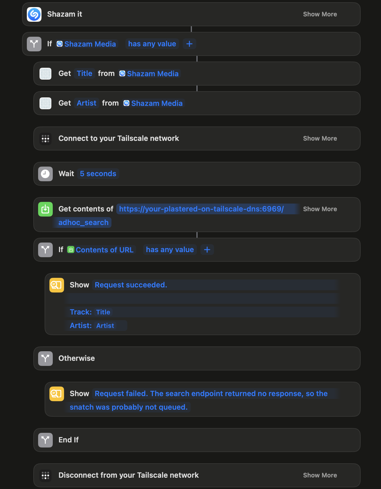

# Usage Examples

## 1. Shazam Integration (via Apple Shortcuts)

If you are running plastered on a private VPN like Tailscale, and you use an iPhone, you can prepare an iOS shortcut
like the example image below shows. This shortcut will kick off Shazam to identify the song your phone is picking up, 
and then it will attempt to submit the artist and song name to plastered to automatically search and download the 
matching song, if a match is found.

NOTE: Replace the DNS with your plastered service's Tailscale DNS and port number.

